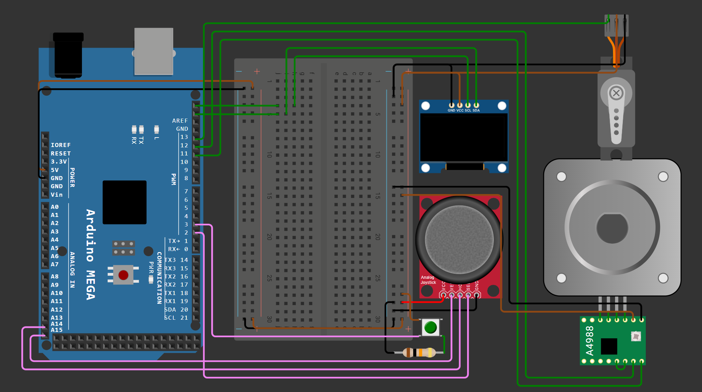
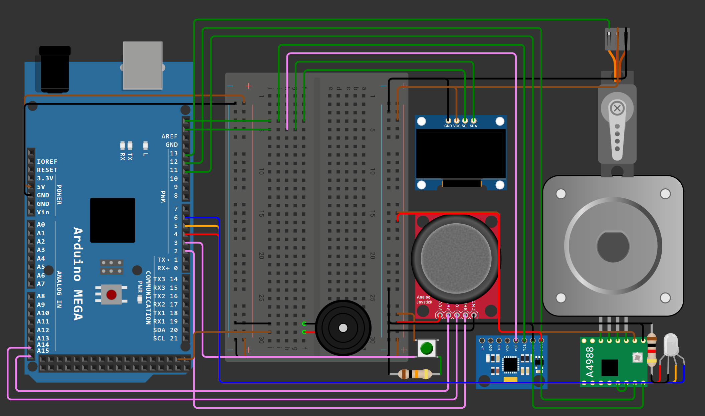
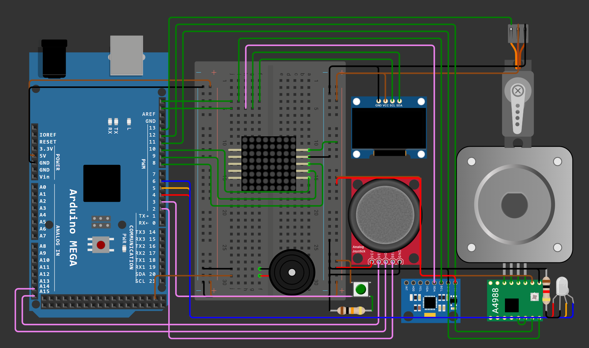

# Arduino Drill Controller

An Arduino Mega/Wokwi project exploring joystick control of a simulated drilling arm, vibration-triggered interlocks, and an LED-matrix hazard display. Originally developed as the **Thalassic Excavator** embedded-systems exercise.

**[Open and run in Wokwi](https://wokwi.com/projects/465840256063564801)**

The original Level 2 sketch, editable circuit and library list are included. On 20 October 2026, the online simulation started and its OLED displayed **1. Control Drill**. This was a startup check; the motion, feedback and hazard-display scenarios still need individual testing. See [verification notes](docs/verification.md).

## Source files and running the project

| File | Purpose |
| --- | --- |
| `sketch.ino` | Original Level 2 Arduino firmware |
| `diagram.json` | Editable Wokwi circuit using an Arduino Mega |
| `libraries.txt` | Wokwi library dependencies |
| `wokwi-project.txt` | Original export's project link |

These four files are preserved byte-for-byte from the supplied Wokwi project's export. Earlier firmware versions are represented by their reports; separate Level 0 and Level 1 sketches have not been recovered.

To run the simulation, open the Wokwi link and press Start. Check the OLED menu, then exercise the joystick, select/back buttons and sensor inputs. The sketch uses Adafruit GFX Library, Adafruit SSD1306 and Servo, plus the Arduino core's Wire and SPI libraries. For a local Arduino IDE build, place `sketch.ino` inside a folder named `sketch`, install the listed libraries and select Arduino Mega 2560. A local build has not been verified.

## Documented development stages

| Stage | Features described in the report | Report |
| --- | --- | --- |
| 0: interface and motion | OLED menu, joystick input, select/back buttons, stepper depth control and servo tilt | [Level 0](docs/submission/level-0-report.docx) |
| 1: vibration feedback | MPU6050-based vibration metric, RGB feedback, buzzer and a retract-only response after a hard-rock event | [Level 1](docs/submission/level-1-report.docx) |
| 2: mapping and readings | Drill animation, hazard-depth logging, a readings menu and LED-matrix graph display | [Level 2](docs/submission/level-2-report.docx) |

The reports describe the implementation approach and debugging history. Their requirements include responsive scheduling without `delay()`, interrupt-driven select/back inputs and bounded hazard storage. Compliance and complete runtime behavior have not been independently tested here.

## Hardware shown in the submitted diagrams

- Arduino Mega.
- Analog joystick and an additional push button.
- I2C OLED display.
- Stepper motor with an A4988 driver and a servo motor.
- MPU6050 motion sensor in the feedback stages.
- RGB LED and buzzer for status/interlock feedback.
- MAX7219-style 8×8 LED-matrix module in the mapping stage.

The stage diagrams are historical Wokwi snapshots. The recovered Level 2 firmware defines these pins:

| Function | Arduino Mega pins |
| --- | --- |
| Joystick vertical / horizontal | A15 / A14 |
| Select / back | 2 / 3 |
| Stepper direction / step | 11 / 12 |
| Servo | 13 |
| RGB red / green / blue | 4 / 5 / 6 |
| Buzzer | 22 |
| Matrix data / chip select / clock | 8 / 9 / 10 |
| OLED / MPU6050 | I2C, addresses `0x3C` / `0x68` |

## Circuit diagrams

### Interface and motion

### Vibration feedback and interlock

### Hazard mapping and display

## Submitted recordings

- [Stage 0 recording](https://drive.google.com/file/d/1DPsZVRSRvrXB0LwuJ75AtvsVDSbADhUV/view) — `Level_0.mkv`, approximately 68.1 MB.
- [Stage 1 recording](https://drive.google.com/file/d/1VMMDrOzgt0JvMdCT57NRFqtiZ7Od7ujr/view) — `Level_1.mkv`, approximately 29.8 MB.
- [Stage 2 recording](https://drive.google.com/file/d/1LcFLCSrh0hfGbNf_W9HodWCG2g3zlqwF/view) — `Level_2.mp4`, approximately 319.9 MB.

These are existing submission recordings, retained on Drive rather than copied into Git history. Drive's existing access settings apply. They have not been independently reviewed frame by frame; the new startup check is documented separately.

## Development notes

The mapping-stage report records several iterations of drill animation: removing trailing pixels, avoiding blocking delays, constraining matrix addressing and simplifying the animation logic. It also describes a bounded hazard graph with up to eight display columns.

The recovered sketch provides Control Drill and View Readings menus, stepper/servo control, RGB/buzzer feedback, a jam flag that gates downward movement, drill animation and hazard arrays capped at 10 entries. The graph displays up to eight entries.

The function named `getjerk()` computes the magnitude of the MPU6050's scaled X/Y gyroscope readings. This is an exercise feedback metric; calibrated physical jerk or material hardness has not been established. Hazard data is held in memory.

## Known limitations in the original sketch

- The code contains a one-second startup delay and a five-second hard-rock warning delay, despite the exercise's nonblocking scheduling requirement.
- `SendData()` accepts addresses 1–8 only. The MAX7219 configuration writes in `setup()` use addresses 9–15, so those writes are skipped. Matrix behavior needs follow-up testing and correction.
- The jam flag clears when the feedback metric falls below its threshold; physical retraction is not independently enforced by that flag.

The original firmware is unchanged. Startup verification does not establish correct behavior for every menu, motion, hazard or matrix-display case.

## Files and provenance

| Folder | Contents |
| --- | --- |
| `docs/submission/` | Reports retrieved from the supplied Drive submission |
| `docs/circuits/` | The three submitted PNG circuit diagrams |
| `archive/local/` | Earlier local report copies, preserved separately |

[Source Drive folder](https://drive.google.com/drive/folders/1tcv4Tossfqg1NjhqLnVZBN4WMbcAC4-o). The available files were collected on 20 October 2026. Original reports and images are unchanged; their repository copies were checked with SHA-256 hashes, and the Word document archives passed integrity checks.

The Level 2 source was recovered from the [user-supplied Wokwi project](https://wokwi.com/projects/465840256063564801) on 20 October 2026. Its export passed ZIP integrity checks, all four copied source files matched their exported SHA-256 hashes, and the circuit JSON parsed successfully with 14 parts and 54 connections. See [verification notes and startup evidence](docs/verification.md).
