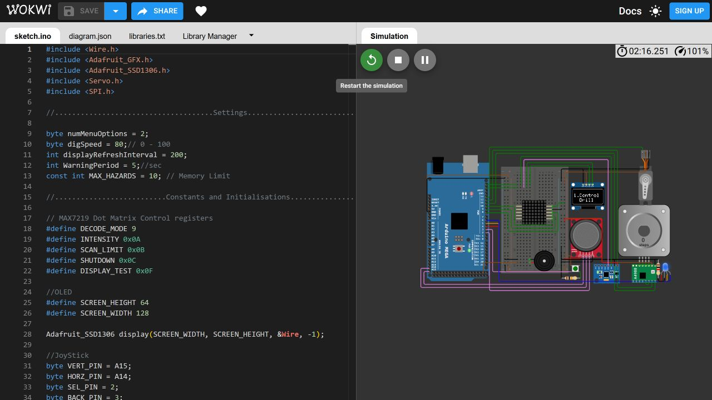

# Source recovery and verification

Checked on 20 October 2026.

## Original source

Downloaded the original ZIP export from [Spider EE Level 2 on Wokwi](https://wokwi.com/projects/465840256063564801). The archive passed its ZIP integrity check. The following files were copied unchanged to the repository root and checked against the export using SHA-256:

- `sketch.ino`
- `diagram.json`
- `libraries.txt`
- `wokwi-project.txt`

The circuit JSON parsed successfully. It contains 14 parts and 54 connections; connection endpoints reference existing parts. The controller is an Arduino Mega.

## Online startup check

Started the supplied project in Wokwi. The simulation timer advanced and the OLED displayed **1. Control Drill**. No build-error dialog was observed. The simulation was stopped after the check, and no website code was edited.

This confirms observed startup in the online simulator. It does not establish a fresh local compilation or whether Wokwi used a cached build. Joystick navigation, motion, warning handling, hazard storage and matrix rendering have not been exhaustively tested.

## Source inspection findings

- `setup()` uses `delay(1000)` and the hard-rock handler uses `delay(WarningPeriod * 1000)` with a five-second warning period. These block execution despite the report's nonblocking requirement.
- `SendData()` rejects register addresses outside 1–8, including the MAX7219 configuration addresses 9–15 passed by `setup()`. Those initialization writes are skipped.
- The function named `getjerk()` calculates the magnitude of scaled X/Y gyroscope readings. No physical jerk or material-hardness calibration was verified.
- The jam flag gates downward stepping but clears when the metric falls below its threshold; it does not independently verify retraction.

These findings are documented without modifying the recovered firmware. Earlier submission recordings and reports remain historical evidence, distinct from this startup check.
